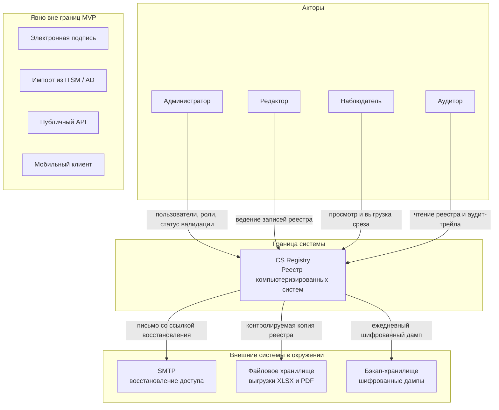
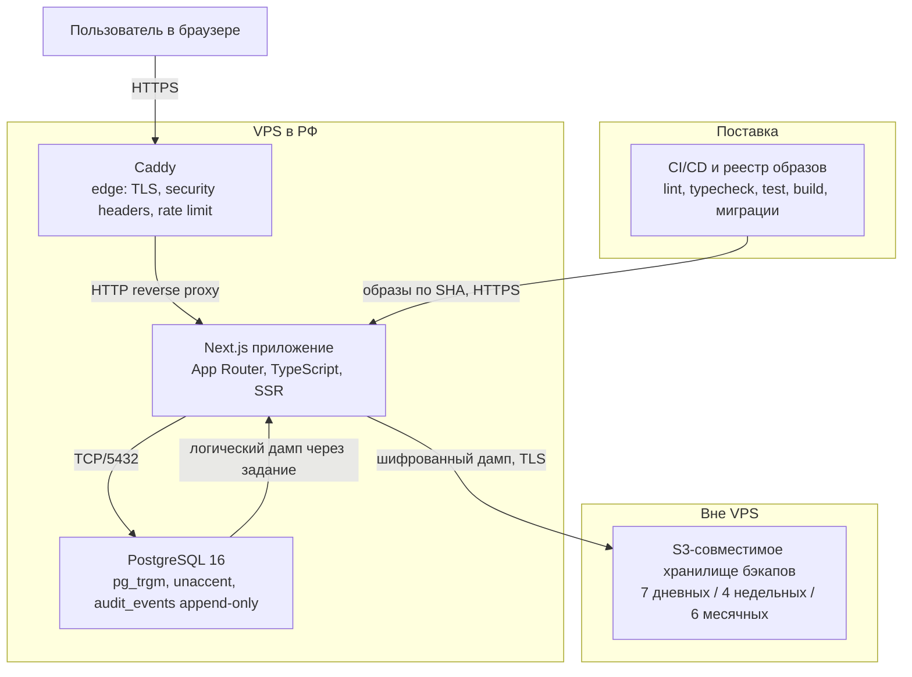
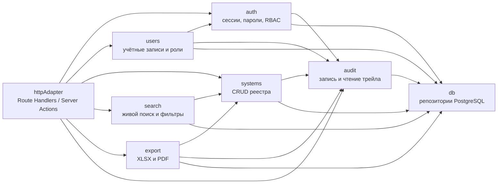

# C4-модель CS Registry

Модель описывает систему как модульный монолит: один деплой, один процесс, транзакционный аудит. Уровни L1–L3 фиксируют решения первичного контекста v0.2.0. Мнемоники узлов — латиницей, подписи — по-русски.

## L1 — System Context

Система в центре. Акторы работают только через защищённый интерфейс. Внешние системы — каналы, которые пересекают границу: почта для восстановления доступа, файлы выгрузок, хранилище резервных копий.

Явно вне границ (нет связей с системой в этом уровне): электронная подпись, импорт из ITSM/AD, публичный API, мобильный клиент.

## L2 — Containers

Один VPS, Docker Compose (`web`, `db`, `caddy`). Сборку образов выполняет CI, тег неизменяемый по SHA. Резервные копии уходят во внешнее S3-совместимое хранилище — вне доступа прикладной роли БД.

Протоколы на связях:

| Связь | Протокол | Назначение |
|---|---|---|
| Браузер → Caddy | HTTPS | Единственный вход пользователей |
| Caddy → Next.js | HTTP (внутренний контур) | Reverse proxy после терминации TLS |
| Next.js → PostgreSQL | TCP/5432 | Прикладная роль БД, без UPDATE/DELETE на `audit_events` |
| CI/CD → хост / реестр | HTTPS | Сборка и публикация образов с тегом SHA |
| Next.js → S3-хранилище | TLS | Выгрузка шифрованного дампа и контрольных точек хеш-цепочки |

## L3 — Components

Компоненты совпадают с каталогами `src/server/modules/`. HTTP-адаптер (Route Handlers и Server Actions) — не домен: он вызывает модули и не содержит бизнес-правил.

Правила зависимостей (без исключений):

1. Доменный слой (`auth`, `users`, `systems`, `search`, `export`, `audit`) не импортирует HTTP: ни Route Handlers, ни Server Actions, ни объекты запроса/ответа.
2. Доступ к БД — только через репозитории в `db`. SQL и Drizzle не вызываются из обработчиков HTTP напрямую.
3. Модуль `audit` не зависит ни от чего, кроме `db`. Остальные модули пишут события, вызывая `audit`, а не наоборот.
4. Циклов между доменными модулями нет: `users` использует `auth` для хеширования и отзыва сессий; `search` и `export` читают реестр через `systems`, не дублируя правила карточки.

## L4 — Code

Уровень L4 Code не фиксируется до реализации и строится из кода после появления модулей.

## Границы доверия и что пересекает границу системы

Доверенный контур — процесс Next.js, PostgreSQL и Caddy на VPS. Всё, что покидает этот контур, считается вышедшим из-под прикладного контроля и должно быть либо обезличено, либо зашифровано, либо зарегистрировано в аудите.

| Что пересекает границу | Направление | Почему это важно | Как закрываем |
|---|---|---|---|
| Персональные данные | Вход и выход | ФИО, логин, email сотрудников; владелец процесса, владелец системы и владелец качества в реестре | TLS, RBAC, маскирование секретов в аудите, выгрузка не расширяет состав полей |
| Экспорт в файлы XLSX/PDF | Выход | Точная копия среза реестра по 11.10(b) покидает систему | Формирование на сервере, событие `export` в аудите, идентификатор отчёта, TLS-скачивание |
| Резервные копии | Выход | Полный дамп, включая `password_hash` и аудит | Шифрование до отправки, хранение вне VPS, прикладная роль БД не имеет доступа к бакету |
| Контрольные точки хеш-цепочки | Выход | Последний `id` и `hash` аудита | Ежедневная запись во внешнее хранилище, вне прикладной роли |
| Логи приложения | Выход | Диагностика, correlation ID | Запрет паролей, токенов и лишних ПДн в pino; логи не заменяют аудит-трейл |
| Письма SMTP | Выход | Адрес электронной почты и токен восстановления | TLS к SMTP, письмо не содержит текущего пароля |
| Учётные данные на входе | Вход | Пароль — секрет | HTTPS, Argon2id, блокировка после 5 неудач, rate limit на Caddy |

Электронная подпись, импорт из ITSM/AD, публичный API и мобильный клиент границу не пересекают: их нет в объёме. Место под ЭП оставляется в схеме, реализация — вне текущего уровня.
