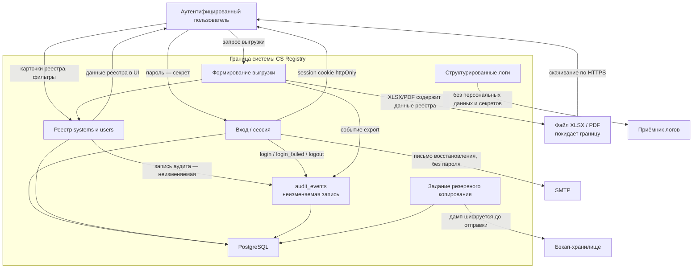

# Контекстная диаграмма потоков данных

Диаграмма показывает **границы системы и потоки данных** с пометками чувствительности. Это не C4 L1: там — акторы и контейнеры, здесь — что именно движется через границу и какой у этого класс защиты.

Внутри границы: аутентифицированный интерфейс, доменные модули, PostgreSQL, неизменяемый журнал `audit_events`. Снаружи: человек за браузером, SMTP, файл выгрузки, шифрованный бэкап, приёмник логов.

## Поток → данные → классификация → что защищает

Классификация ниже — рабочая для этого контура. Значения `data_classification` у записи системы (public / internal / confidential / personal) описывают **данные внутри компьютеризированной системы**, а не класс самого реестра. Сам реестр как журнал учёта КС обрабатывается как внутренние данные организации с вкраплением персональных (ФИО, email, логин).

| Поток | Данные | Классификация | Что защищает |
|---|---|---|---|
| Вход аутентификации | `username`, пароль в открытом виде только на время TLS-сессии | Секрет | HTTPS, Argon2id, минимум 12 символов, блокировка после 5 неудач за 15 минут, rate limit, сессия в httpOnly cookie `SameSite=Lax` |
| Сессия | Идентификатор сессии в cookie | Секрет | httpOnly, ротация при смене пароля, отзыв всех сессий при деактивации |
| Чтение и запись реестра | Карточка системы, владелец процесса, владелец системы, владелец качества, критичность, статус валидации | Внутренние; ФИО владельца процесса, владельца системы и владельца качества — персональные | RBAC на сервере, запрет по умолчанию, оптимистичная блокировка `version` |
| Запись аудита | Снимок актора, действие, `before`/`after`, `reason`, `request_id`, хеш-цепочка | Внутренние, неизменяемые | Время из БД, append-only, нет UPDATE/DELETE у прикладной роли, триггер, `prev_hash`/`hash`; секреты в `before`/`after` маскируются до записи |
| Чтение аудита | Тот же журнал | Внутренние | Только `admin` и `auditor`; само чтение пишет событие `read_audit` |
| Выгрузка XLSX/PDF | Срез реестра по фильтрам, параметры выгрузки, SHA версии, идентификатор отчёта | Покидает границу; состав = данные реестра, без расширения ПДн | Формирование на сервере, событие `export`, TLS-скачивание, колонтитулы и лист параметров для происхождения копии |
| Резервная копия | Полный дамп БД, включая `password_hash` и `audit_events` | Секрет + внутренние | Шифрование до отправки с VPS, хранение вне прикладной роли, 7/4/6 ротация, ежемесячная проверка восстановления |
| Контрольная точка хеша | Последний `audit_events.id` и `hash` | Внутренние, целостность | Ежедневная запись во внешнее хранилище |
| Логи приложения | `requestId`, маршрут, код ответа, длительность | Внутренние технические; **без ПДн и секретов** | Политика pino: пароли, токены, `password_hash`, `mfa_secret` и тела карточек не логируются |
| SMTP восстановления доступа | Email, одноразовый токен | Персональные + секрет | TLS к SMTP, токен не равен паролю, письмо не содержит реестр |

Выгрузка и бэкап — единственные потоки, которые уносят содержимое реестра целиком или срезом за границу. Логи этот состав **намеренно не повторяют**, чтобы канал диагностики не стал обходным путём к персональным данным.
