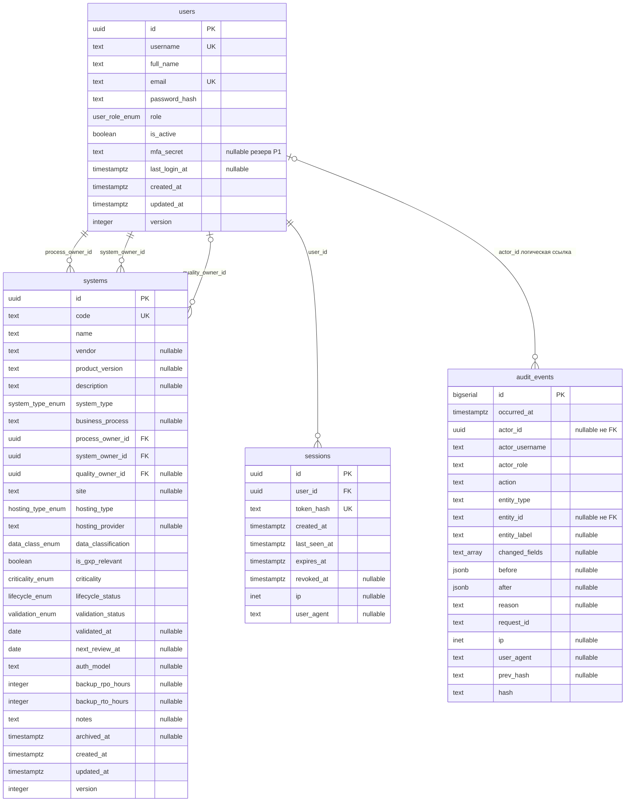

# ER-модель

Четыре сущности: `users`, `sessions`, `systems`, `audit_events` (раздел 5 контекста). У `users` и `systems` первичный ключ UUID, `created_at` / `updated_at` (`timestamptz`, UTC) и `version` для оптимистичной блокировки. У `sessions` — UUID, без `version`. У `audit_events` — отдельный контракт: `bigserial`, append-only, без `updated_at` и без `version`. В `sessions` хранится `token_hash`, не токен cookie.

Связь `audit_events.actor_id` → `users.id` на диаграмме логическая: колонка nullable и **не** оформляется как внешний ключ с каскадом (см. пояснения ниже).

Перечисления (значения фиксируются приложением и справочным листом выгрузки):

| Колонка | Значения |
|---|---|
| `users.role` | `admin`, `editor`, `viewer`, `auditor` |
| `systems.system_type` | 35 значений в формате код / полное название / группа. Полный перечень — FS §2.7. Группы — только UI, не колонка БД. Коды 0.5.0 не переименовываются. |
| `systems.hosting_type` | `on_prem`, `cloud`, `hybrid` |
| `systems.data_classification` | `public`, `internal`, `confidential`, `personal` |
| `systems.criticality` | `low`, `medium`, `high` |
| `systems.lifecycle_status` | `planned`, `active`, `maintenance`, `retired` |
| `systems.validation_status` | `not_validated`, `in_validation`, `validated`, `not_required` |

`audit_events.action`: `create`, `update`, `archive`, `restore`, `activate`, `deactivate`, `login`, `login_failed`, `logout`, `role_change`, `password_reset`, `export`, `read_audit`, `read_system_history`. `activate`/`deactivate` — учётные записи; архив систем — `archive`/`restore`. `entity_type`: `systems`, `users`, `auth`.

Кардинальности: у системы ровно один `process_owner_id` и ровно один `system_owner_id` (оба NOT NULL, FK на `users.id`); `quality_owner_id` необязателен (nullable FK на `users.id`). Один и тот же пользователь может занимать несколько ролей на одной записи — раздельного CHECK «лица различны» контекст не задаёт. Пользователь не удаляется, поэтому исторические ссылки на владельцев остаются валидными FK. Одно событие аудита ссылается не более чем на одного актора; системные события — без актора.

## Почему поля устроены так

- **`audit_events.actor_id` nullable и не FK с каскадом.** Системные события (контрольная точка, фоновое задание) не имеют пользователя. Если бы это был FK с `ON DELETE CASCADE`, деактивация или гипотетическое удаление учётки уничтожило бы историю — прямое нарушение ALCOA+ Original/Complete. Даже `ON DELETE SET NULL` стёр бы атрибуцию; атрибуция держится на снимках `actor_username` и `actor_role`. Логическая связь нужна для фильтров «события этого пользователя», физический каскад — нет.
- **`audit_events.entity_id` — `text`, а не внешний ключ.** Журнал пишет события по разным типам (`systems`, `users`, `auth`), у части событий объекта нет (неуспешный вход с неизвестным логином). FK на одну таблицу это запретил бы. Идентификатор хранится как текст, тип объекта — в `entity_type`; ссылочная целостность здесь не цель, цель — несбрасываемая история.
- **История объекта не выносится в отдельную таблицу.** Лента в карточке — выборка из `audit_events` по `(entity_type, entity_id)`. Вторая таблица или денормализованная копия дали бы второй источник правды: запись в реестр могла бы попасть в журнал и не попасть в «историю», или наоборот. ALCOA+ Original/Complete требуют один журнал. Составной индекс `(entity_type, entity_id, id)` обслуживает эту выборку от новых к старым (btree читается в обе стороны).
- **`actor_username`, `actor_role`, `entity_label` — снимки на момент события, а не ссылки.** Attributable и Legible требуют, чтобы запись читалась без join и после смены ФИО, роли или наименования системы. Ссылка на текущую карточку показала бы «кто этот человек сейчас», а не «кто сделал это тогда».
- **`audit_events.id` — `bigserial`, а не UUID.** Хеш-цепочка и проверка порядка опираются на монотонный идентификатор: `prev_hash` предыдущей записи однозначно находится как `id - 1` в рамках одной последовательности. UUID не даёт порядка вставки и усложняет ежедневную контрольную точку «последний id + hash».
- **`process_owner_id` и `system_owner_id` обязательны и разделены.** GAMP 5 Second Edition §6.1.2 требует определить и довести роли владельца процесса и владельца системы (и кто что одобряет). Это не предписание колонок реестра — реестр так обеспечивает определённость ролей. Смешение в одном безымянном `owner_id` и замене `technical_owner_id` стирает Process vs System Owner. Владелец процесса (бизнес) отвечает за пригодность процесса, требования, валидацию, поддержание валидированного состояния и целостность данных; владелец системы (ИТ) — за архитектуру, администрирование, поддержку, безопасность, патчи и резервное копирование. Для валидации КС и ALCOA+ Attributable нужна явная атрибуция ответственности: кто отвечает за пригодность процесса и данные, кто — за платформу. Оба FK NOT NULL на `users.id`. `quality_owner_id` остаётся nullable: подразделение качества в §6.1.2 тоже называется среди ролей, но назначение конкретного лица на каждую запись реестра не всегда применимо.
- **Пользователи деактивируются, а не удаляются.** На `users.id` ссылаются `systems.process_owner_id` / `system_owner_id` / `quality_owner_id` и логический `actor_id`. Физическое удаление либо ломает FK реестра, либо вынуждает каскадом трогать историю. `is_active = false` сохраняет атрибуцию, закрывает вход и отзывает сессии.
- **`systems.code` неизменяем после создания.** Человекочитаемый ключ (`SYS-0001`) — идентификатор в выгрузках, аудите (`entity_label` может меняться с именем) и в ссылках инспекции. Смена кода после создания рассинхронизировала бы копии XLSX/PDF и прошлые события с текущей карточкой. Код генерируется сервером и больше не принимается в PATCH.

## Индексы и почему они такие

| Индекс | Тип | Зачем |
|---|---|---|
| `systems.name`, `systems.vendor`, `systems.code` | GIN `pg_trgm` | Живой поиск подстроки без выделенного поискового движка на объёме до 5 000 записей. Триграммы закрывают опечатки и частичные совпадения вендоров латиницей. |
| `systems.system_type` | btree | Фильтр по типу из URL, высокая селективность по справочнику. |
| `systems.criticality` | btree | Фильтр критичности, комбинируется по И с остальными. |
| `systems.lifecycle_status` | btree | Фильтр жизненного цикла (`status` в API). |
| `systems.process_owner_id` | btree | Фильтр по владельцу процесса и join на `users` при отображении ФИО. |
| `systems.next_review_at` | btree | Сортировка и будущие выборки «переоценка до даты»; уведомления в MVP нет, индекс дешёвый и совпадает с колонкой риска. |
| `systems.code` unique, `users.username` unique, `users.email` unique | btree unique | Идентичность логина, почты и кода системы. |
| `audit_events.occurred_at`, `actor_id`, `entity_type`+`entity_id`+`id`, `action` | btree | Фильтры журнала и история объекта в карточке; P95 выборки за месяц < 1 с. Составной `(entity_type, entity_id, id)` заменяет двухколоночный индекс по сущности. |

`unaccent` — не индекс, а нормализация значения до сравнения: `unaccent(lower(...))`. Она снимает диакритику (латиница вендоров: `é` → `e`) и выравнивает русские варианты вроде «ё»/«е», чтобы запрос «Citroen» находил «Citroën», а «софт» — написание с «ё». Вместе с `pg_trgm` это даёт подстрочный поиск по нормализованной форме без `citext` и без отдельного морфологического движка. Морфология русского языка сверх unaccent+триграмм в MVP не обещается: стемминг и словарь синонимов в объём не входят.

Дополнительно уникальность `code` защищает генератор `SYS-NNNN`. Индекс по `archived_at` в контексте не задан: основной список отфильтровывает `archived_at IS NULL` после остальных btree-предикатов; при росте архива индекс можно добавить отдельно, не меняя модель.
